# k8s-sre-platform

A local, production-style platform for a B2B SaaS + AI product, running on upstream Kubernetes (kind) managed entirely by Argo CD:
GitOps, the LGTM observability stack (Mimir · Loki · Tempo · Grafana), Argo Workflows, and an **AI SRE agent that investigates alerts on its own**, writes structured RCAs, runs four scheduled proactive reviews, and improves its own accuracy week-over-week through self-learning.

One command creates the three clusters and installs Argo CD. Everything else is pulled from this repo.

```
alert fires (Grafana alerting)
  → webhook (Flask, sre-agent namespace)
  → Argo Workflow (incident-investigation WorkflowTemplate)
  → agent queries Mimir, Loki, Tempo, Kubernetes, Argo CD
  → structured RCA report (Markdown + JSON, stored on a PVC)
  → notification (chat webhook or Slack)
```

---

## Runs on

Linux or WSL2. Required on PATH: `docker`, `kind`, `kubectl`, `helm`, `python3` (3.9+). `bootstrap/bootstrap.py` checks each one at startup and stops with an install hint if any is missing.

| | Requirement |
|---|---|
| Docker memory | Three clusters use ~9 GB idle; 16 GB is the practical minimum (at 12 GB the WSL VM stopped answering under 30 broken workloads) |
| WSL2 | `memory=16GB`, `swap=8GB` in `%UserProfile%\.wslconfig`; `vmIdleTimeout=-1` so the VM survives a closed terminal |
| CPU | 4 cores minimum; 8 recommended |
| Ports | 7080/7443, 9080/9443, 8080/8443 on localhost — `bootstrap.py` stops with the port number if one is already taken |

---

## Quick start

```bash
git clone https://github.com/krishnakant888/k8s-sre-platform && cd k8s-sre-platform
export ANTHROPIC_API_KEY=sk-...        # optional — enables LLM analysis in the agent
python3 bootstrap/bootstrap.py
```

What the script does:

1. Creates three kind clusters with Calico for NetworkPolicy:
   - `platform` — 1 control plane + 2 workers
   - `observability` — 1 control plane + 1 worker
   - `gitops` — 1 control plane
2. Installs Argo CD in the `gitops` cluster only
3. Registers `platform` and `observability` as spoke clusters in Argo CD
4. Seeds all Secrets with random values (Argo CD admin password, Grafana admin password, gateway basic-auth, API fault token, GitHub/Grafana tokens as empty placeholders)
5. Applies the root Application — Argo CD takes over from there and syncs everything from this repo (first sync ~10 minutes)

All URLs, logins and tokens are printed at the end. Print them again any time:

```bash
python3 bootstrap/bootstrap.py --credentials
```

**Partial operations:** `--only platform`, `--only observability`, or `--only gitops` to create (or with `--destroy`, tear down) one cluster without touching the others.

**Full teardown:** `python3 bootstrap/bootstrap.py --destroy`

### URLs

| What | Cluster | URL | Auth |
|---|---|---|---|
| Argo CD | gitops | https://argocd.localhost:7443 | `admin` / own random login |
| Grafana | observability | https://grafana.localhost:9443 | `admin` / own random login |
| Developer portal (Backstage) | gitops | https://backstage-portal.localhost:7443 | guest sign-in (read-only) |
| Argo Workflows UI | observability | https://workflows.localhost:9443 | gateway basic auth |
| RCA reports viewer | observability | https://reports.localhost:9443 | gateway basic auth |
| Sample API | platform | https://orders.localhost:8443/orders | none |
| dummy-shop | platform | http://dummy.localhost:8080 | none |

Each URL also works over plain HTTP on the `…080` port (7080, 9080, 8080). TLS certificates are self-signed (cert-manager), so browsers warn once. The Workflows UI and RCA viewer are protected by Traefik basic auth (`admin` / random, created at bootstrap) — a local stopgap for SSO.

The LGTM backends (Mimir, Loki, Tempo, Alloy) are not published on the gateway; query them in Grafana or via port-forward:

```bash
kubectl --context kind-observability -n observability port-forward svc/mimir 8081:8080
kubectl --context kind-observability -n observability port-forward svc/loki 3100:3100
kubectl --context kind-observability -n observability port-forward svc/tempo 3200:3200
kubectl --context kind-observability -n observability port-forward svc/alloy 12345:12345
```

`*.localhost` resolves to 127.0.0.1 in browsers — no hosts file changes needed.

---

## Architecture

Three clusters, each responsible for one concern, so an outage, upgrade or rebuild of one cannot take down the tools used to debug it:

```
gitops cluster          Argo CD (hub) — deploys both other clusters from this repo
platform cluster        workloads (orders-api, frontend, dummy-shop), gateway, kyverno, sealed-secrets
observability cluster   LGTM stack, Argo Workflows, SRE agent, RCA viewer
```



Clusters communicate over the shared Docker network. Collectors push to `observability-worker:<NodePort>`; the agent reads `platform-control-plane:6443` and `gitops-control-plane:6443` with read-only tokens created at bootstrap.

```mermaid
flowchart LR
    classDef git   fill:#dbeafe,stroke:#3b82f6,color:#1e3a5f,font-weight:bold
    classDef plat  fill:#dcfce7,stroke:#16a34a,color:#14532d,font-weight:bold
    classDef obs   fill:#ffedd5,stroke:#ea580c,color:#7c2d12,font-weight:bold
    classDef store fill:#fef9c3,stroke:#ca8a04,color:#713f12
    classDef ext   fill:#f1f5f9,stroke:#94a3b8,color:#0f172a

    Dev(["👨‍💻 Developer\n\npushes code\ntriggers templates"]):::ext
    GH[("📦 GitHub\nthis repo")]:::ext

    subgraph GC["🔵  gitops cluster"]
        ArgoCD["🔄 Argo CD  —  hub + spoke\n━━━━━━━━━━━━━━━━━━━━━━━\nSingle deployer for\nboth other clusters.\nSyncs everything from Git;\nnothing is applied by hand.\n─────────────────────────\nargocd.localhost:7443"]:::git
        Backstage["🏢 Backstage Developer Portal\n━━━━━━━━━━━━━━━━━━━━━━━━━━━\nService catalog  ·  live pod status\nArgo CD health  ·  open alerts\n13 self-service Scaffolder templates\n──────────────────────────────────\nbackstage-portal.localhost:7443"]:::git
    end

    subgraph PC["🟢  platform cluster  —  the workloads"]
        direction TB
        WorkloadGrp["⚡ orders-api  🌐 frontend  🛍️ dummy-shop\n━━━━━━━━━━━━━━━━━━━━━━━━━━━━━━━━━━━━━━━━━\nFastAPI + 28-day SLO (99.5% success + p99 ≤ 300ms)\nnginx with traceparent header logging\n─────────────────────────────────────────────────\norders.localhost · app.localhost · dummy.localhost"]:::plat
        Infra["🛡️ Traefik  (Gateway API controller)\ncert-manager  ·  Kyverno policies\nSealed Secrets controller"]:::plat
        PAlloy["📡 Alloy collector\nkube-state-metrics\n─────────────────\nscrapes: pods · cAdvisor\ntails: pod logs via k8s API\nforwards: OTLP traces"]:::plat
        WorkloadGrp -->|"metrics · logs\nOTLP traces"| PAlloy
    end

    subgraph OC["🟠  observability cluster  —  the tools  (isolated: survives a platform outage)"]
        direction TB

        Mimir["📊 Mimir\nmetrics · SLO\nrecording rules"]:::obs
        Loki["📋 Loki\nlogs"]:::obs
        Tempo["🔍 Tempo\ntraces"]:::obs
        Grafana["📈 Grafana\n━━━━━━━━━━━━━━━━\ndashboards (provisioned from Git)\nalert rules  ·  SLO burn-rate\ncontact points  ·  silences\n────────────────────────────\ngrafana.localhost:9443"]:::obs

        Webhook["🚨 Alert Webhook\nFlask · idempotent\n(409 on duplicate fingerprint)"]:::obs
        AW["⚙️ Argo Workflows\n━━━━━━━━━━━━━━━━\nruns agent steps as pods\nretries + timeouts per step\n────────────────────────\nworkflows.localhost:9443"]:::obs

        Agent["🤖 SRE Agent\n━━━━━━━━━━━━━━━━━━━━━━━━━━━━━━━━━━━━━━━━━\nIncident flow:  settle → collect → analyze → store → notify\nRule-based classifier  (30+ cause families)\n+  LLM verification  (Claude)  when API key set\n─────────────────────────────────────────────\nScheduled CronWorkflows  (all IST):\n• capacity-review    daily   06:30  — scale-down PR if under-used\n• floor-review       Mon     07:00  — min-replica floor report\n• health-review      Mon     08:00  — restarts · HPA · change risk\n• self-learning      Sun     09:00  — rediagnose · gaps → issues\n                                       calibrate · tune thresholds"]:::obs

        Reports[("📁 reports PVC\n─────────────\nrca.md  +  report.json\n14-day retention\nnightly cleanup CronJob")]:::store
        Viewer["🖥️ RCA Viewer UI\n━━━━━━━━━━━━━━━━━━━━━\nlive 0–100% progress bar\nper-service 30-day sparklines\nmanual workflow triggers\n─────────────────────────\nreports.localhost:9443"]:::obs

        Grafana   -->|"alert fires\nPOST /webhook"| Webhook
        Webhook   -->|"Workflow.create()\none per alert fingerprint"| AW
        AW        -->|"step pods execute"| Agent
        Agent     -->|"read-only:\nMimir · Loki · Tempo"| Mimir
        Agent     --> Loki
        Agent     --> Tempo
        Agent     -->|"write RCA"| Reports
        Viewer    -->|"read reports"| Reports
        Viewer    -->|"poll status.progress"| AW
    end

    Dev       -->|"git push / PR"| GH
    GH        -->|"GitOps pull\n(app-of-apps)"| ArgoCD
    ArgoCD    -->|"sync → platform"| Infra
    ArgoCD    -->|"sync → observability"| Grafana
    PAlloy    -->|"remote-write metrics\npush logs  ·  push traces\n(Docker network NodePorts)"| Mimir
    PAlloy    --> Loki
    PAlloy    --> Tempo
    Agent     -->|"read-only k8s API\npods · events · Argo CD apps"| PC
    Agent     -.->|"Argo CD API\ndeploy history"| GC
    Dev       -->|"open UIs"| Grafana
    Dev       -->|" "| ArgoCD
    Dev       -->|" "| Viewer
    Dev       -->|" "| AW
    Dev       -->|" "| Backstage
```

### Namespace map

| Namespace | Cluster | Contents |
|---|---|---|
| `argocd` | gitops | Argo CD hub — manages itself and both other clusters |
| `demo` | platform | `orders-api`, `frontend` |
| `sandbox` | platform | `dummy-shop` (nginx + trace logging, no OTel SDK) |
| `observability` | platform | Alloy collector, kube-state-metrics |
| `observability` | observability | Mimir, Loki, Tempo, Grafana, Alloy, kube-state-metrics |
| `argo-workflows` | observability | Argo Workflows controller and UI |
| `sre-agent` | observability | alert webhook, WorkflowTemplates, CronWorkflows, RCA viewer, PVC |
| `kyverno` | platform | policy engine and admission controller |
| `traefik` / `cert-manager` | all three | gateway (Traefik, Gateway API) and TLS issuer |

---

## Repo layout

```
bootstrap/              kind configs (platform, observability, gitops) + bootstrap.py
gitops/apps/            platform cluster Argo CD Applications (one per component, AppProjects, sync waves)
gitops/observability-cluster/  observability cluster Applications, Alloy values, NodePorts
gitops/hub/             gitops cluster: Argo CD values, root Applications
gitops/observability/   Mimir, Loki, Tempo, Grafana configs, alert rules, dashboards
gitops/workloads/       manifests for orders-api, frontend, sre-agent (WorkflowTemplates, CronWorkflows, UI)
gitops/fault-drills/    fault injection manifests (active, degraded scenarios)
backstage-portal/       Backstage app + self-service templates
apps/orders-api/        FastAPI sample service: code, tests, Dockerfile
apps/sre-agent/         agent code: webhook, RCA, steps, learning, tools
docs/                   RCA samples, runbooks, observability architecture, secrets guide
scripts/                drill.sh, faults.py, coverage_audit.py
```

---

## The AI SRE agent

### Incident investigation

Alert fires in Grafana → Grafana calls `POST /webhook` → agent creates one Argo Workflow (`incident-investigation` WorkflowTemplate), named from the alert fingerprint so a repeated notification gets a 409 and does not start a second run.

**Steps:**
1. **Settle** — 20-second suspend for data to arrive in the stores
2. **Collect** — queries Mimir (error ratio, p99, CPU, memory), Loki (top error logs), Tempo (slow/failing traces), Kubernetes (pod state, events, restarts), Argo CD (recent syncs); output is a compact evidence JSON
3. **Analyze** — rule-based classifier maps evidence to ~30 root-cause categories; with `ANTHROPIC_API_KEY`, Claude gets the same evidence + read-only tools and must call `submit_rca` with a schema-validated report
4. **Store** — writes `<id>/rca.md` and `report.json` to the reports PVC
5. **Notify** — sends a summary to a chat webhook

**Classification families covered:** container (waiting, crash loop), scheduling (pending, unschedulable), rollout (stuck deployment, StatefulSet, DaemonSet), job (failed), memory (near limit, OOM kill), cpu (throttled), volume (filling, almost full, failed PVC), target (service down), node (not ready, pressure, CPU/memory saturated), controlplane (API server errors, slow), dns, ingress, gateway, certificate, argocd (degraded, missing), telemetry (gap, collector down), datasource (unavailable), hpa (saturated).

**Agent properties:**
- Read-only by construction — write access is limited to the reports PVC
- Playbook-first — structured queries run before any LLM call; the report is complete without one
- Honest — reports carry the exact queries, evidence, confidence level, contributing factors, and a flag when a fault injection drill is active
- Tool output is treated as data, never as instructions; secrets are redacted from log lines; the LLM loop has a step limit

### Automated remediation: how the agent extends HPA

Kubernetes HPAs handle horizontal scaling (adding/removing pods) but cannot raise resource limits when a container is throttled or killed. The agent fills that gap with **vertical remediation** — it patches `limits` and `requests` in the GitOps manifests and opens a PR, which Argo CD applies on merge.

**Division of responsibility**

| Concern | Who handles it | Mechanism |
|---|---|---|
| Scale out more pods | HPA | Compares actual CPU/memory usage against `requests`; adds pods when utilisation exceeds the target percentage |
| Scale in fewer pods | HPA | Removes pods when utilisation drops below the target |
| Raise CPU limit (throttled) | Agent (incident remediation) | Detects `container_cpu_cfs_throttled_ratio > 25%`; patches `limits.cpu` × 1.5 and sets `requests.cpu` to 50% of the new limit |
| Raise memory limit (OOM kill) | Agent (incident remediation) | Detects `kube_pod_container_status_last_terminated_reason == OOMKilled`; patches `limits.memory` to peak + 20% headroom; sets `requests.memory` to the same value (Guaranteed QoS) |
| Lower limits over time | Scale-down agent (daily) | Checks CPU P95 and Mem P99 against per-service thresholds; PRs a reduction when usage stays below threshold for the review window |

**Why `requests` must be patched alongside `limits`**

The HPA derives utilisation as `actual usage ÷ requests`. If the agent raises `limits.cpu` from 200m to 300m but leaves `requests.cpu` at 50m, HPA sees 400% utilisation and immediately scales out pods — the opposite of what was needed. Setting `requests.cpu` to 50% of the new limit gives HPA an accurate baseline and lets it make a correct scale-out decision once the limit change is live.

For memory, `requests.memory` is set equal to `limits.memory` to maintain Guaranteed QoS (Kubernetes does not evict Guaranteed pods under node memory pressure).

**HPA requirements on kind clusters**

HPAs need the `metrics.k8s.io/v1beta1` API, which is served by [metrics-server](https://github.com/kubernetes-sigs/metrics-server). It is not installed by default in kind. The cluster ships a `gitops/apps/metrics-server.yaml` ArgoCD Application that deploys metrics-server 3.12.2 with `--kubelet-insecure-tls` (required because kind kubelets use self-signed TLS). Without this, all HPAs show `ScalingActive: False` and never fire.

**What the agent does NOT do**

The agent never changes `spec.replicas` directly. Replica management is entirely owned by the HPA; the agent touches only `resources.limits` and `resources.requests` in the deployment manifests.

### Scheduled proactive reviews

Four CronWorkflows run on a fixed schedule (all times IST):

| CronWorkflow | Schedule | What it does |
|---|---|---|
| `sre-capacity-review` | Daily 06:30 IST | Checks CPU P95 and Mem P99 against per-service thresholds; opens a PR to reduce replicas or resource limits when consistently under-utilised; scale-down is guarded by a 24h cooldown and a 15-minute post-merge hold |
| `sre-weekly-capacity-floor-review` | Mondays 07:00 IST | Derives the minimum safe replica floor from 7-day peak traffic; writes a recommendation report (read-only, no PR) |
| `sre-weekly-health-review` | Mondays 08:00 IST | Scans all workloads for restart storms (≥5 restarts/7d), HPA saturation (≥10% of time at max), and risky recent deploys (error rate doubled within 168h of a deploy); writes a cluster health report |
| `sre-self-learning` | Sundays 09:00 IST | Re-diagnoses unknown-cause incidents; opens GitHub issues for repeated observability gaps; recalibrates per-family confidence weights; tunes per-service thresholds from 30-day Mimir telemetry |

All four can be triggered manually from the RCA viewer UI. In-flight workflows show a live 0–100% progress bar driven by Argo's `status.progress` step counter.

### Self-learning (four passes)

The self-learning workflow runs every Sunday. It improves report quality and threshold accuracy over time without manual tuning:

**Pass 1 — Unknown rediagnosis.** Re-runs the classifier against every past report with `root_cause: unknown`, using 30 days of Mimir and Loki data that may not have been available at incident time. Reports whose cause is now determinable are updated and noted in the weekly report with a link to the original.

**Pass 2 — Gap tracker.** Groups past reports by the observability gaps they flagged. When a gap is seen ≥3 times it opens (or updates) a GitHub issue in the repo labelled `observability-gap`, tagged by service and gap type. The self-learning report lists all open gap issues with links, counts, and new-this-week highlights.

**Pass 3 — Confidence calibration.** For each alert family, compares the confidence score the agent assigned against the actual outcome (incident confirmed vs. noise). Adjusts per-family weights stored in `.calibration.json`. The report shows the before/after weight table and which families improved.

**Pass 4 — Threshold tuning.** For each workloads service, fetches 30 days of daily CPU P95 and Memory P99 from Mimir, alongside the incident dates and capacity-review dates from that period. Updates per-service thresholds in `.thresholds.json`. The report includes a sparkline chart (CPU + memory time series with incident markers and threshold lines) for every service that was adjusted, rendered as inline SVG in the RCA viewer — no Grafana dependency at view time.

### RCA viewer UI

Browse reports at https://reports.localhost:9443 (gateway basic auth).

**Features:**
- **Report list** — all RCAs with alert type, service, priority, root cause, confidence and timestamp; click to expand the full Markdown RCA
- **Progress strip** — active Argo Workflows (incident or scheduled) show a live 0–100% fill bar; label shows "Self-learning 50%…"; re-discovered after page reload from Argo's k8s API
- **Self-learning report** — five sections: rediagnosed reports with before/after cause; gap issues table with GitHub links and new/total counts; calibration weight table; threshold cards with 30-day sparklines (blue CPU P95, amber Mem P99, dashed red threshold, red tick per incident date)
- **Trigger buttons** — manually start any of the four CronWorkflows from the UI
- **Facts panel** — platform-wide counts: open gap issues (N new / M total tracked), incident count, confidence distribution

---

## Try a failure drill

```bash
scripts/drill.sh latency     # also: errors, oom, kill, reset
```

1. The API's downstream call becomes slow; the SLO dashboard (`Services / orders-api: RED and SLO`) shows the error budget burning.
2. `OrdersApiErrorBudgetFastBurn` fires in Grafana and calls the agent webhook.
3. An Argo Workflow `incident-ordersapierrorbudgetfastburn-...` starts (Argo Workflows UI or `kubectl --context kind-observability -n sre-agent get wf`).
4. The agent stores `<id>/rca.md` and `report.json` on the reports volume; browse them at https://reports.localhost:9443.

Sample reports for each drill scenario: [docs/rca-samples](docs/rca-samples).

---

## Fault injection: does the agent get it right?

`scripts/faults.py` injects 36 kinds of fault and checks each RCA report against the expected conclusion (alert, root-cause category, application vs infrastructure layer):

```bash
scripts/faults.py list                       # every fault, its expected alert and conclusion
scripts/faults.py run-each all disruptive    # one at a time: inject → wait → judge → clean up (~6 h for all)
scripts/faults.py run-each crash oom         # just these two
scripts/faults.py start all                  # inject all 31 non-disruptive faults together (sandbox namespace)
scripts/faults.py check                      # PASS / WRONG / NO ALERT per fault (wait ~15 min after start)
scripts/faults.py clear
```

**Results (one fault at a time):** 35 of 36 faults produce a report with the expected alert, cause and layer; 0 are wrong. The one fault with no report is `partition` — it cuts off the only node running Grafana, the alert path and the agent, so nothing is left to alert or investigate. That is the design case for a dead man's switch (roadmap).

Faults covered: crash loops by cause (missing setting, read-only filesystem, dependency refused, network policy block, unresolvable name, clean exit), image pull errors (missing tag, unreachable registry), missing Secret or ConfigMap, unschedulable pods (capacity, node selector, unbound volume), OOM kill, CPU throttling, failing liveness/readiness probes, failed Job, stuck rollout, namespace quota, ephemeral-storage eviction, ingress errors (5xx, slow backend, missing backend), Argo CD issues (unrenderable manifests, unhealthy resources, policy rejection), platform add-on scaled to zero, collector gone, node down.

`scripts/coverage_audit.py` checks every Deployment, StatefulSet and DaemonSet in all three clusters for missing metrics, missing logs, missing labels, missing memory limits, missing probes, and missing PodDisruptionBudgets.

---

## Backstage developer portal

https://backstage-portal.localhost:7443 — a service catalog with live pod status, Argo CD health, and open alerts per component, plus self-service Scaffolder templates:

| Template | What it does |
|---|---|
| New service | Scaffolds a FastAPI service, Dockerfile, CI workflow, and ArgoCD Application |
| Deploy image tag | Opens a PR to bump the image tag in the service's deployment |
| Roll back service | Opens a PR to revert to the previous image tag |
| Scale service | Opens a PR to adjust replica count |
| Change resources | Opens a PR to adjust CPU/memory requests and limits |
| Add hostname | Opens a PR to add an HTTPRoute hostname |
| Set environment variable | Opens a PR to add/update an env var in the deployment |
| Promote to demo | Copies a sandbox workload to the demo namespace |
| Request sandbox | Creates a sandbox namespace with network policies |
| Request access | Opens a GitHub issue for RBAC access |
| Request alert | Opens a PR to add a Grafana alert rule |
| Request dashboard | Opens a PR to add a Grafana dashboard |
| Run failure drill | Triggers a fault injection scenario |

---

## Observability

**Metrics** — Alloy scrapes annotated pods, kube-state-metrics and cAdvisor (kubelet) and remote-writes to Mimir. Tempo's metrics generator adds span metrics and a service graph.

**Logs** — Alloy tails pod logs through the Kubernetes API (no hostPath, so Pod Security `baseline` holds) into Loki. Apps log JSON with `trace_id`, so Grafana jumps from a log line to its trace.

**Traces** — apps send OTLP to Alloy, which forwards to Tempo. Grafana links traces to logs and metrics.

**Dashboards and datasources** are provisioned from Git (ConfigMaps picked up by the Grafana sidecar).

### SLO

`orders-api`: 99.5% of requests succeed (non-5xx) **and** finish within 300 ms, over 28 days (~3h 22m error budget). The SLI comes from one histogram with a `status` label (a slow 500 is counted once). Alerts use multiwindow, multi-burn-rate: 14.4× over 1h + 5m pages; 6× over 6h + 30m opens a ticket. See [docs/runbooks/orders-api.md](docs/runbooks/orders-api.md).

### Alert rules

| File | Covers |
|---|---|
| `rules-generic.yaml` | 30+ platform-wide alerts across all families listed above |
| `rules-orders-api.yaml` | SLO burn rate, error ratio, latency, saturation for `orders-api` |
| `rules-platform.yaml` | Infrastructure: nodes, control plane, cert-manager, Argo CD |

Notable alerts: `ArgoCDAppDegraded` fires when any Argo CD Application reports `health_status=Degraded` with a summary naming the specific app and its likely causes; `ArgoCDAppMissing` fires when resources are `Missing` from the cluster.

---

## Production posture

| Area | What is in place |
|---|---|
| GitOps | Argo CD app-of-apps; AppProjects restrict repos, namespaces and cluster resources; automated sync with prune and self-heal; sync waves for ordering. After bootstrap nothing is applied by hand. |
| Isolation | One namespace per concern; default-deny ingress and egress NetworkPolicies with explicit allows; Pod Security labels (`restricted` enforced for `demo` and `sre-agent`). |
| Workloads | Requests and limits sized from measured usage ([docs/RESOURCES.md](docs/RESOURCES.md)); startup/readiness/liveness probes; non-root; read-only root filesystem; drop ALL capabilities; seccomp `RuntimeDefault`; PodDisruptionBudgets; topology spread constraints; pinned image tags (CI writes the commit SHA to Git). |
| Guardrails | Kyverno requires resource settings, pinned tags and non-root pods (enforced in `demo` and `sre-agent`, audit elsewhere). |
| RBAC | Dedicated ServiceAccounts; no token auto-mounted unless needed; Argo CD default role is read-only. |
| Secrets | Not in Git. Created at bootstrap with random values; Sealed Secrets controller installed for encrypted-in-Git secrets ([docs/secrets.md](docs/secrets.md)). |
| Supply chain | CI: tests → image build → dependency scan → push to GHCR → tag bump commit. `yamllint` and `kubeconform` on every PR. |
| Logging | Structured JSON everywhere with trace correlation. |
| Config changes | ConfigMaps carry a content hash annotation so a rule or config change rolls the pod. |

---

## If clusters disappear after a machine restart

Kind nodes are Docker containers. `bootstrap.py` gives them a restart policy, so they come back with Docker. On WSL2 also set `vmIdleTimeout=-1` in `%UserProfile%\.wslconfig`; without it WSL stops the VM when no terminal is open. If that setting was missing at bootstrap time, run `python3 bootstrap/bootstrap.py` once — it only adds the policy to clusters that already exist.

---

## Design decisions and trade-offs

**kind with Calico.** Reproducible, one command up and down. kind has no Gateway API controller and its default CNI does not enforce NetworkPolicy, so Calico is installed at bootstrap and Traefik (as a Gateway API controller) is deployed by Argo CD in every cluster.

**Gateway API, not Ingress.** Routes are `HTTPRoute` objects on one `Gateway` per cluster, so a controller swap doesn't touch routes. ingress-nginx was dropped: its Helm admission-webhook hook Jobs collided with Argo CD syncs. Traefik and cert-manager have no Helm hooks (cert-manager startup check is off), verified by rendering them.

**Observability in a separate cluster.** The tools you debug with must not fail with what they watch. Collectors run in the platform cluster and ship out; stores, Grafana and alerting live in `observability`, so observability survives a production rebuild. A third cluster (`gitops`) runs the one Argo CD that deploys both, so the deployer depends on neither. Cost: a second cluster to run, and a link between them (NodePorts on the Docker network locally; internal load balancers with TLS in the cloud). If the platform cluster is unreachable, Grafana still shows history but the agent has nowhere to reach for pod/event data.

**Local disk (PVCs) instead of object storage.** Mimir, Loki and Tempo run single-binary with data on PVCs. Moving to object storage is a config change in each tool's storage block. (MinIO was tried and dropped: images are no longer pullable from its registry.)

**Alerting lives in Grafana.** Alert rules, contact point and notification policy are ConfigMaps in Git loaded by the Grafana sidecar. Mimir runs only the SLO recording rules. One UI for dashboards, alert state and silences; no Alertmanager to operate.

**Reports on a PVC, not ConfigMaps.** ConfigMaps are capped at 1 MiB and live in etcd forever. Reports are plain files on a 2 Gi volume with a 14-day nightly cleanup job. On kind the volume is a folder on one node; on EKS/AKS it is a managed disk or the store step uploads to S3/Blob. The JSON line in Loki stays the durable searchable copy.

**Argo Workflows instead of a durable-execution engine.** An investigation is a short linear pipeline; retries, timeouts and a visible history are enough, and Argo Workflows is Kubernetes-native and managed by GitOps with no database. Trade-offs: no durable timers or signals in code (the settle step is a 20 s suspend), and data moves as workflow parameters capped at ~150 KB (the agent trims evidence to fit). A long-lived or branching process would justify Temporal or Restate.

**Rule-based analysis plus an LLM.** The agent is useful without an API key and testable without a model. The model adds verification and better prose. With no key (or on API failure) the rule-based report is kept and labelled `mode: rule_based`.

**Secrets seeded at bootstrap.** Sealed Secrets are bound to a cluster key; secrets committed for one cluster cannot be decrypted on another. Seeding at bootstrap keeps the repo runnable from scratch without a private key in Git.

---

## Moving to EKS or AKS

Only environment specifics change: storage classes (`gp3` / `managed-csi`), gateway controller and TLS (ALB or App Gateway + cert-manager), External Secrets in place of bootstrap seeding, replica counts, PVC sizes, and optionally object storage for the LGTM backends. The Argo CD apps, AppProjects, policies, dashboards, alert rules, and the agent are unchanged.

---

## Roadmap

1. External Secrets Operator with a real backend; cert-manager and production TLS.
2. Object storage and distributed modes for Mimir, Loki and Tempo.
3. Progressive delivery (Argo Rollouts) with SLO-based analysis so a bad deploy rolls back automatically.
4. Agent: human-approval suspend step in the workflow before any remediation; remediation playbooks (restart, rollback PR); evaluation suite from recorded incidents; cost and token budgets.
5. Dead man's switch: an independent watcher that pages when the alert path or the agent itself stops (the partition fault demonstrates this gap).
6. Per-environment overlays with ApplicationSets; alert-driven weekly SLO status page.
7. Kyverno image signature verification (cosign) and SBOMs.

---


