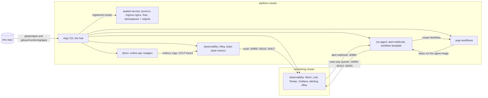

# k8s-sre-platform

A local, production-style platform for a B2B SaaS + AI product, running on upstream Kubernetes (kind) and managed entirely by Argo CD:
GitOps, the LGTM observability stack, Argo Workflows, a sample API with an SLO, and an **AI SRE agent that investigates alerts on its own**
and writes a structured, blameless RCA.

One command creates the cluster and installs Argo CD. Everything else is pulled from this repo.

```
alert fires (Grafana alerting) -> webhook -> Argo Workflow -> SRE agent queries Mimir, Loki, Tempo,
Kubernetes and Argo CD -> structured RCA (files on a volume, JSON log in Loki, optional chat webhook)
```

## Quick start

Needs Linux or WSL2 with: Docker, [kind](https://kind.sigs.k8s.io), kubectl, helm, Python 3.9+ (standard library only). About 10 GB of RAM free.

```bash
git clone https://github.com/krishnakant888/k8s-sre-platform && cd k8s-sre-platform
export ANTHROPIC_API_KEY=...        # optional, enables LLM analysis in the agent
python3 bootstrap/bootstrap.py
```

The script creates two kind clusters with Calico for NetworkPolicy and the few secrets each needs with random values: `platform` (1 control plane, 2 workers) first, then `monitoring` (1 control plane, 1 worker).
Argo CD is installed **only in the monitoring cluster**. The script registers the platform cluster in it, and that one Argo CD deploys both clusters from this repo. The first sync takes about 10 minutes. It prints the logins at the end.
Use `--only monitoring` or `--only platform` to create or destroy one of them.

| What | Cluster | URL |
|---|---|---|
| Grafana | monitoring | http://grafana.localhost:9080 |
| Argo CD (deploys both clusters) | monitoring | http://argocd-monitoring.localhost:9080 |
| Argo Workflows UI | platform | http://workflows.localhost:8080 |
| Sample API | platform | http://orders.localhost:8080/orders |
| RCA reports | platform | http://reports.localhost:8080 |

`*.localhost` resolves to 127.0.0.1 in browsers, no hosts file changes. Tear down with `python3 bootstrap/bootstrap.py --destroy` (add `--only platform` to keep monitoring running).

## Try the failure drill

```bash
scripts/drill.sh latency     # also: errors, oom, kill, reset
```

1. The API's downstream call becomes slow. The SLO dashboard (`Services / orders-api: RED and SLO`) shows the error budget burning.
2. After a few minutes the `OrdersApiErrorBudgetFastBurn` alert fires in Grafana alerting and Grafana calls the agent webhook.
3. An Argo Workflow `incident-ordersapierrorbudgetfastburn-...` starts (`kubectl -n sre-agent get wf`, or the Argo Workflows UI).
4. The agent runs a query playbook, classifies the cause, stores the report and logs it:
   the reports are files on a volume (`<id>/rca.md` and `report.json`): browse them at http://reports.localhost:8080, or `kubectl -n sre-agent exec deploy/rca-viewer -- ls /reports`.
5. Grafana `Platform / SRE agent: investigations` lists the reports. Sample reports for each drill are in [docs/rca-samples](docs/rca-samples).

## Architecture

Monitoring runs in its own cluster, so a production outage, upgrade or rebuild cannot take down the tools used to debug it.
Argo CD runs only in the monitoring cluster (hub and spoke) and deploys both clusters: the platform cluster is registered in it, and its apps are Applications there with `destination: platform`. The two clusters talk over the shared Docker network (collectors push to `monitoring-control-plane:<port>`, Argo CD reaches `platform-control-plane:6443`).



| Namespace | Cluster | Contents |
|---|---|---|
| `argocd` | monitoring | the one Argo CD, manages itself and the platform cluster |
| `observability` | platform | Alloy (collector, ships to the monitoring cluster), kube-state-metrics |
| `observability` | monitoring | Mimir (metrics, recording rules), Loki, Tempo, Grafana (dashboards and alerting), Alloy and kube-state-metrics watching the stack itself |
| `argo-workflows` | Argo Workflows controller and UI (runs the workflows in `sre-agent`) |
| `demo` | `orders-api` and a load generator |
| `sre-agent` | alert webhook, workflow template and its step pods, the reports volume (PVC) with a read-only viewer |
| `kyverno`, `ingress-nginx`, `kube-system` | policy engine, ingress controller, sealed-secrets controller |

## Repo layout

```
bootstrap/          kind configs (platform, monitoring) + the one imperative script
gitops/root/        the root Applications (app of apps), one per cluster
gitops/apps/        production cluster: one Application per component, AppProjects, sync waves
gitops/monitoring/  monitoring cluster: its Applications, Argo CD values, Alloy values, network policies, NodePorts
gitops/platform/    namespaces, network policies, RBAC, Kyverno policies, operator values
gitops/observability/  Mimir, Loki, Tempo, Grafana, Alloy configs, rules, dashboards (deployed by the cluster that owns each Application)
gitops/workloads/   orders-api, frontend, sre-agent manifests (including the workflow template)
apps/orders-api/    sample service (FastAPI): code, tests, Dockerfile
apps/sre-agent/     the agent: tools, RCA, workflow steps, webhook
scripts/drill.sh    failure drills
docs/               secrets, runbooks, RCA samples
```

## Observability

- **Metrics** Alloy scrapes annotated pods, kube-state-metrics and cAdvisor (read from the kubelet) and remote-writes to Mimir. Tempo's metrics generator adds span metrics and a service graph.
- **Logs** Alloy tails pod logs through the Kubernetes API (no hostPath, so Pod Security `baseline` holds) into Loki. Apps log JSON with `trace_id`, so Grafana jumps from a log line to its trace.
- **Traces** apps send OTLP to Alloy, which forwards to Tempo. Grafana links traces to logs and metrics.
- **Dashboards and datasources** are provisioned from Git (ConfigMaps picked up by the Grafana sidecar).

### SLO

`orders-api`: 99.5% of requests succeed (not 5xx) **and** finish within 300 ms, over 28 days (error budget about 3h 22m).
The SLI is computed from one histogram with a `status` label, so a slow 500 is counted once.
Alerts are Grafana alert rules using multiwindow, multi-burn-rate ([rules file](gitops/observability/alerting/rules-orders-api.yaml)):
14.4x over 1h and 5m pages, 6x over 6h and 30m opens a ticket. Runbook: [docs/runbooks/orders-api.md](docs/runbooks/orders-api.md).

## Argo Workflows and the operational workflow

The `incident-investigation` WorkflowTemplate ([workflow-template.yaml](gitops/workloads/sre-agent/workflow-template.yaml)): wait for data to settle, collect evidence, analyze,
store the report, notify. Each step is a pod running the agent image (`python -m agent.steps <step>`) with retries, backoff and a timeout, so a flaky query does not lose the investigation, and a restart of the webhook does not affect a run in flight.
The webhook creates one Workflow per firing alert, named from the alert fingerprint and start time, so a repeated notification gets a 409 and does not start a second run.

## The AI SRE agent

- **Read only by construction.** Tools are bounded (time range, row count, output size) and the ServiceAccount can only read pods, events and Argo CD applications. It can write one thing: report files on its own volume.
- **Playbook first.** A fixed set of queries (error ratio, p99, replicas, restarts, top error logs, slow and failing traces, pod state, events, recent Argo CD syncs) produces evidence and a rule based classification: dependency latency, dependency errors, pod crash, resource exhaustion (OOM), deploy regression or unknown.
- **LLM on top.** With `ANTHROPIC_API_KEY`, Claude gets the evidence plus the same read only tools and must verify it, then submit a report that validates against a schema (`submit_rca`). If the key is missing or the call fails the rule based report is kept and says `mode: rule_based`.
- **Honest output.** Reports carry the evidence with the exact query, a confidence level, contributing factors, and say when a fault injection flag is active (a drill).
- Tool output is treated as data, never as instructions, secrets are redacted from log lines, and the loop has a step limit.

## Production posture

| Area | What is in place |
|---|---|
| GitOps | Argo CD app of apps, AppProjects restrict repos, namespaces and cluster resources, automated sync with prune and self-heal, sync waves for ordering. After bootstrap nothing is applied by hand. |
| Isolation | One namespace per concern, default-deny ingress and egress with explicit allows, Pod Security labels (restricted enforced for our workloads). |
| Workloads | Requests and limits sized from measured usage ([docs/RESOURCES.md](docs/RESOURCES.md)), startup/readiness/liveness probes, non-root, read-only root fs, drop ALL capabilities, seccomp, PDBs, topology spread, pinned image tags (CI writes the commit sha into Git). |
| Guardrails | Kyverno requires resource settings, pinned tags and non-root pods (enforced in `demo` and `sre-agent`, audit elsewhere). |
| RBAC | Dedicated ServiceAccounts, no token mounted unless needed, Argo CD default role is read-only. |
| Secrets | Not in Git. Created at bootstrap with random values; the Sealed Secrets controller is installed for encrypted secrets in Git ([docs/secrets.md](docs/secrets.md)). |
| Supply chain | CI: tests, image build, dependency scan, push to GHCR, tag bump commit. yamllint and kubeconform on every PR. |
| Logging | Structured JSON everywhere with trace correlation. |
| Config changes | Config and rule ConfigMaps are generated with a content hash, so a change rolls the pod. |

## Design decisions and trade-offs

- **kind with Calico.** Upstream Kubernetes in containers: reproducible, one command up and down, works on Linux, WSL2 and macOS. kind has no ingress controller and its default CNI does not enforce NetworkPolicy reliably, so Calico is installed at bootstrap and ingress-nginx is deployed by Argo CD (host ports 8080/8443 map to its NodePorts).
- **Monitoring in a separate cluster.** The tools you debug with must not fail with what they watch. Production only runs collectors and ships out; the stores, Grafana and alerting live in the `monitoring` cluster with their own Argo CD, so monitoring survives a production rebuild. Cost: a second cluster to run, and the link between them. Locally that link is NodePorts on the kind Docker network with no authentication; in the cloud it would be internal load balancers or private endpoints with TLS and per-tenant credentials. If the production cluster is down, Grafana still shows history, but alerts that need the SRE agent have nowhere to go.
- **Local disk (PVCs) instead of S3.** Mimir, Loki and Tempo run single binary with their data on PVCs. That is the production plan for this stage, and the cost is no scale-out. Moving to object storage later is a config change in each tool's storage block. I tried MinIO first and dropped it: its images are no longer pullable.
- **Mimir monolithic, Loki and Tempo single binary.** Fits a laptop. Production would run them in distributed mode with replication.
- **Alerting lives in Grafana.** Alert rules, the contact point and the notification policy are ConfigMaps in Git that the Grafana sidecar loads. Mimir only runs the SLO recording rules. One UI for dashboards, alert state and silences, and no separate Alertmanager to operate or keep alive.
- **Reports on a PVC, not ConfigMaps.** ConfigMaps live in etcd, are capped at 1 MiB and never expire. Reports are plain files on a 2Gi volume with a nightly cleanup job (14 days) and a read-only viewer. With kind that volume is a folder on one node and is lost with the cluster; on EKS or AKS it is a managed disk, or the store step uploads to S3 or Blob. The JSON line in Loki stays the searchable copy.
- **Argo Workflows instead of a durable-execution engine.** An investigation is a short linear pipeline, so retries, timeouts and a visible history are enough, and Argo Workflows is Kubernetes-native, managed by GitOps and needs no database. Trade-offs: no durable timers or signals in code (the 20 s settle is a suspend step), and data moves between steps as workflow parameters, capped at about 150 KB (the agent trims evidence to fit). A long-lived or branching process would justify Temporal or Restate.
- **Secrets seeded at bootstrap.** Sealed Secrets are bound to a cluster key, so secrets committed for my cluster could not be decrypted on yours. Seeding at bootstrap keeps the repo runnable from scratch without putting a private key in Git.
- **No HPA locally.** metrics-server is disabled to save resources. With it enabled the API gets an HPA on CPU.
- **Rule based analysis plus an LLM.** The agent is useful without an API key and testable without a model; the model adds verification and better prose.
- **TLS is not enabled** on the local ingress. Ingress objects are ready for cert-manager.

## Moving to EKS or AKS

Only environment specifics change: storage classes (`gp3` / `managed-csi`), the ingress controller and TLS (ALB or App Gateway plus cert-manager), Sealed Secrets or bootstrap seeding replaced by External Secrets, replicas and PVC sizes, and optionally object storage for the LGTM backends.
The Argo CD apps, projects, policies, dashboards, rules and the agent are unchanged.

## Roadmap

1. External Secrets Operator with a real backend, cert-manager and TLS.
2. Object storage and distributed modes for Mimir, Loki, Tempo.
3. Progressive delivery (Argo Rollouts) with SLO-based analysis, so a bad deploy is rolled back automatically.
4. Agent: human approval step (a suspend) in the workflow before any remediation, remediation playbooks (restart, rollback PR), evaluation suite of recorded incidents, cost and token budgets.
5. Multi-cluster Argo CD with ApplicationSets, per-environment overlays.
6. Alert-driven SLO reporting workflow (weekly) and a status page.
7. Kyverno image signature verification (cosign) and SBOMs.

## AI usage

This repo was built with Claude Code as a pair engineer: architecture options, manifests, the agent, tests, and debugging. The full session log is in [docs/ai-log](docs/ai-log).
