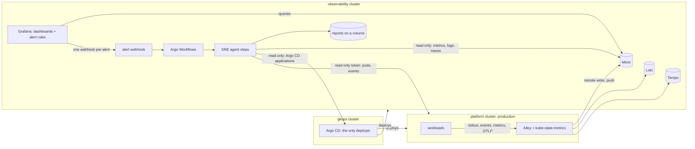

# Observability architecture and RCA design

What this platform does to see a problem, tell the right person once, and explain it. Everything described here is built and was exercised with the
fault catalogue (`scripts/faults.py`); the last section lists what is not built.

## Principles

1. **Alert on what users feel, explain with what the platform knows.** Symptom alerts (error budget burn, ingress 5xx and latency) page. Cause alerts (crash loop, image pull, scheduling, node, volume) open tickets and give the agent its starting point.
2. **One identity for every signal.** Metrics, logs, events and traces carry the same labels: `cluster`, `namespace`, `pod`, `node`, `service`, `version`. One dashboard, one alert rule and one investigation work for any workload in any cluster.
3. **Nothing per application.** A new workload is observed because the collector discovers it, not because someone configured it. The only contract is the standard labels (`app.kubernetes.io/name`, `version`, `team`) and resource limits, both checked by Kyverno.
4. **Each problem is delivered exactly once.** A fault raises several alerts; they become one notification each (nothing grouped away, nothing dropped) and one investigation per workload.
5. **The monitoring watches itself.** Missing telemetry per cluster, undelivered samples, dropped logs, failed investigation workflows and unreachable datasources all alert.
6. **The agent only reads.** Bounded queries, read-only tokens, secrets redacted from log lines, and it says what it could not see.

## Architecture



Why three clusters: the tools used to deal with an outage must not live in the thing that is broken (platform), and the thing that deploys everything (gitops) must not depend on either. Argo CD holds the credentials for the other two, so it runs alone.
Cost of the layout: about 13 GB of RAM for the three clusters plus tests (see the sizing section of the README).

## Signals and the label contract

| Signal | Collected by | Labels added at collection |
|---|---|---|
| Metrics | every pod with a container port named `metrics` or the `prometheus.io/scrape` annotation; cAdvisor and the kubelet of every node; the API server; kube-state-metrics | `cluster`, `namespace`, `pod`, `node`, `service`, `version` |
| Logs | every container (JSON or plain), through the Kubernetes API | the same, plus `container` and a `level` read from the JSON or guessed from the text |
| Events | every Kubernetes event, as logs with `service="kubernetes-events"` | `cluster`, `namespace` |
| Traces | OTLP from any app, through the collector | `k8s.cluster.name` resource attribute |

Lessons that cost time and are now guarded:

- A series that names its own `namespace` or `pod` (kube-state-metrics, Argo CD) must keep it: the scrape uses `honor_labels`, otherwise the real namespace ends up in `exported_namespace` and every query by namespace is wrong.
- Cardinality has a budget. The API server and etcd latency histograms were half of all series; the collector keeps the SLI histogram (verb and scope only) and the sum and count of the etcd one. About 61k active series for three clusters; the Mimir limit is 600k (4x the default).
- Pods that finished or failed are not tailed or scraped. 123 evicted pods once held 123 idle log streams and 1.2 GB.
- Finished investigation objects are deleted after an hour; 381 of them (100 KB each) held the API server at 1.7 GB.

## Alerting

| Layer | Examples | Severity | Purpose |
|---|---|---|---|
| Service level | error budget fast burn (14.4x over 1 h and 5 m) and slow burn (6x over 6 h and 30 m), no replicas, p99 latency | page / ticket | user impact of a service that has an SLO |
| Ingress | 5xx ratio above 5%, p95 above 1 s | page / ticket | user impact of anything behind an Ingress, with no per-app work |
| Workload | container waiting (crash loop, image pull, config error), pod stuck pending or unschedulable, rollout stuck, StatefulSet / DaemonSet not ready, job failed, pod failed, memory near limit, CPU throttled, scrape target down | ticket | the cause side; starts the investigation |
| Platform | node not ready or under pressure, node CPU / memory saturated, API server errors and latency, CoreDNS errors, a critical add-on with no replica (including scaled to zero), volume filling up | page / ticket | what many workloads share |
| GitOps | application out of sync, unhealthy, sync failing | ticket | deployments that do not land |
| Meta-monitoring | telemetry missing from a cluster, samples not delivered, logs dropped, investigation workflow failed, datasource unreachable | page / ticket | the monitoring itself |

Delivery rules (each learned from a failure):

- **Every alert instance is its own notification** (`group_by: ["..."]`, up to 20 per call). Grouping by alert name and namespace plus the contact point's limit of 5 alerts per call silently dropped alerts when more than 5 deployments were in trouble in one namespace.
- An alert that never resolves is notified again after 4 hours, not sooner. Drills that need a fresh report first let the alert resolve.
- Rules answer "no data" with OK and "error" with the Grafana datasource alert; both are routed to the agent, which explains them (a store that was briefly down, or is down now).
- Severity decides the starting priority; the agent decides the final one (below).

## Correlation: one problem, one investigation

A single fault typically raises 3 to 5 alerts. A bad image tag raises `ContainerWaiting`, `PodStuckPending`, `DeploymentReplicasUnavailable` and `DeploymentRolloutStuck`. The webhook derives a **target** from the alert labels (cluster, namespace, workload; for Argo CD the application) and starts one investigation per target. An alert whose target was investigated in the last 30 minutes joins that investigation (`investigations_deduplicated_total`). A failed investigation does not count, so the next alert can try again.

## The RCA pipeline

```
alert -> settle (20 s) -> collect evidence -> analyze -> store report -> notify
          Argo Workflow steps, each retried with backoff and a deadline
```

**Collect.** From the alert labels the agent knows the cluster and the object. It reads, with bounded read-only tools: pod and container state and the scheduler's reason, the events about that workload only (filtered before truncation), the last log lines of the workload (unfiltered for crashing workloads, because the message that matters rarely contains the word "error"), metrics (restarts, memory against limit, throttling, node pressure, DNS and API server health), traces, the ingress backend, the Argo CD application and its sync message, and the recent deploy history.

**Decide the cause.** A rule table maps the evidence to a cause, e.g. waiting reason `ImagePullBackOff` plus a `NotFound` pull error is a missing tag; exit 137 with memory at the limit is an undersized limit, while memory growing without levelling off is a leak; a liveness-probe event with exit 0 is the probe killing a healthy process; `FailedCreate` with "exceeded quota" is the namespace quota.

**Decide the layer.** The report says *application* when the fix is in the workload's code, configuration, release or probes, and *infrastructure* when it is in nodes, capacity, scheduling, networking, the registry path, DNS or the platform. The reasoning is listed, and a rule can flip the layer: an unresolvable host name is the application's when CoreDNS is healthy and infrastructure when its SERVFAIL ratio is up; a missing image tag is the application's, an unreachable registry is infrastructure.

**Decide the priority.**

| Level | When |
|---|---|
| P1 | a user-facing service is effectively down (no ready pod, or at least half of requests fail); the control plane or DNS of a cluster fails |
| P2 | page-severity alert, or a serious degradation of something users depend on, or telemetry missing from a cluster (nothing else in it can be detected) |
| P3 | ticket level, or a platform component with no direct user impact (capped at P3 however loud the alert) |
| P4 | recovered, no ongoing impact |

It goes down one level when the signals have recovered.

**Write.** Every report has: what happened (plain sentences with numbers), impact, the layer with reasoning and confidence, root cause category, a timeline, evidence (the exact query and what it returned), the fix as three lists (immediate with exact commands, permanent, how to verify), the priority with its rationale, and **observability gaps** (what was missing and exactly what to add). With an Anthropic key the model runs a read-only tool loop on top of the rule-based result and must end with a report that validates against the same schema; without a key the rule-based report is the report and says so.

## How accuracy is measured

`scripts/faults.py` injects 36 kinds of fault, one at a time (`run-each`) or together, and compares the report the agent wrote with the expected alert, root-cause category and layer of each fault. It also prints which alerts Grafana raised and how it grouped them. The first run, before the fixes listed above, was 16 right, 10 wrong, 10 without a report; the causes were all in the agent's view of the cluster (pending pods invisible, events cut before filtering, log filter too narrow, exit codes misread) and in alert delivery (grouping). Run one fault at a time after those fixes, 35 of 36 give the right report and none a wrong one. The exception is `partition`, which cuts off the only node that runs Grafana, the alert path and the agent, so nothing is left to report it; an independent dead man's switch would. The second round of failures was in the agent (pods the scheduler rejected, name prefixes shared by sibling workloads, a scale-to-zero already reverted by self-heal, an ingress controller with no pod rated P4) and in the harness (root apps undoing the disruptive faults). `scripts/coverage_audit.py` checks that every workload of every cluster sends metrics and logs.

## What is not built

- Continuous profiling, eBPF auto-instrumentation and synthetic probes. Request metrics come from the ingress controller and the app's own histogram; traces need OpenTelemetry in the app.
- Volume-full alerts cannot be exercised on kind (host-path volumes report no usage); the rules are in place for real disks.
- High availability: one Grafana, one Mimir, one Loki, one Tempo, filesystem storage on a volume. In a cloud: object storage, microservices mode or a managed service, Grafana in HA with a shared database.
- An external pager. All alerts go to the agent, which writes the report and can post to a Slack-compatible webhook; paging a human needs an on-call tool behind that webhook, and a second, independent watcher of the whole stack (a dead man's switch).
- Per-service SLOs other than `orders-api`. Any service with a request histogram can get the same recording rules.
- Feedback loop: the reports are not yet rated by the people who read them, which is the data needed to tune the rule table or the model prompt.
